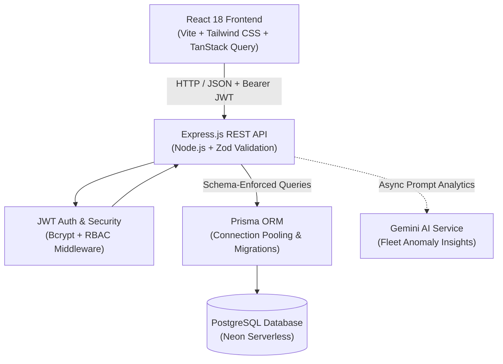

# 🚛 TransitOps – Smart Transport Operations & Fleet Management Platform

[](https://nodejs.org/)
[](https://expressjs.com/)
[](https://react.dev/)
[](https://www.prisma.io/)
[](https://neon.tech/)
[](https://tailwindcss.com/)
[](https://odoo.com)

A full-stack, enterprise-grade Transport Operations and Fleet Management web platform developed for the **Odoo Hackathon 2026**. TransitOps digitizes the entire commercial transport lifecycle—replacing error-prone logistics spreadsheets with automated vehicle lifecycle tracking, driver safety scorecards, dispatch validation state machines, maintenance logging, fuel consumption monitoring, and role-based operational analytics.

---

## 👥 Hackathon Team & Contributor Attribution

Built during the **Odoo Hackathon 2026** by a four-member engineering team. Contributions are accurately reflected in the git commit history:

- **Narasimha Manam** ([@Narasimhamanam](https://github.com/Narasimhamanam)) — **Lead Architect & Full-Stack Engineer (35 commits)**  
  Architected the end-to-end full-stack application; engineered the backend security model, JWT authentication, and RBAC middleware; designed the Prisma schema and relational constraints; integrated the complete REST API suite with frontend React services; built the business-rule dispatch state machine.
- **Akhila Bevara** ([@AkhilaBevara](https://github.com/AkhilaBevara)) — **Quality Assurance & Testing (2 commits)**  
  Configured deployment scripts, verified environment settings, ran system sanity tests, and performed end-to-end validation.
- **Gorju Manikanta Srinivas** ([@gorjumanikantasrinivas](https://github.com/gorjumanikantasrinivas)) — **Frontend Developer (2 commits)**  
  Built interactive analytics dashboards, charts with Recharts, and UI presentation components.
- **Maturi Venkata Sai Pravallika** ([@Pravallika](https://github.com/Narasimhamanam)) — **Backend Contributor (1 commit)**  
  Contributed to initial database seed scripts and entity definitions.

---

## 📐 System Architecture



---

## ⚡ Enforced Business Rules & State Machines

Unlike basic CRUD dashboards, TransitOps enforces real-world operational safety and regulatory constraints at both the database and API middleware layers:

1. **Unique Fleet Registrations:** License plate numbers and vehicle registration IDs must be globally unique.
2. **Vehicle Lifecycle Enforcement:** Vehicles have strict lifecycle states (`AVAILABLE`, `ON_TRIP`, `IN_SHOP`, `RETIRED`). Vehicles in `RETIRED` or `IN_SHOP` cannot be scheduled or dispatched.
3. **Driver Safety & License Guard:** Dispatch automatically blocks drivers with expired driver's licenses or active safety suspensions.
4. **Collision Prevention:** Vehicles or drivers currently marked `ON_TRIP` cannot be assigned to overlapping dispatches.
5. **Payload Capacity Validation:** Cargo weight is validated against the selected vehicle's rated gross capacity; overcapacity dispatches are rejected.
6. **Atomic State Transitions:**
   - **Dispatch:** Atomically transitions vehicle and driver to `ON_TRIP`.
   - **Trip Completion:** Restores vehicle and driver status back to `AVAILABLE`.
   - **Trip Cancellation:** Safely rolls back vehicle and driver allocation.
7. **Maintenance Isolation:** Logging a maintenance order automatically moves the vehicle to `IN_SHOP`. Closing the maintenance log restores vehicle status to `AVAILABLE`.
8. **Automated Expense Pairing:** Fuel entries with an associated trip ID automatically generate synchronized financial expense logs.

---

## 🔐 Role-Based Access Control (RBAC)

The system enforces strict permission boundaries across 4 operational personas:

| Role | Vehicle & Driver Admin | Trip Dispatch & Execution | Maintenance Orders | Fuel & Expense Logs | Operational Analytics |
| :--- | :---: | :---: | :---: | :---: | :---: |
| **Fleet Manager** | Full Access | View Only | Full Access | View Only | Full Dashboard |
| **Dispatcher / Driver** | Read Only (Dropdowns) | Full Access | No Access | No Access | Active Trips Only |
| **Safety Officer** | Safety / Scores Only | Read Only | Audit Logs | No Access | Safety Dashboard |
| **Financial Analyst** | Hidden | No Access | Read Costs | Full Access | Financial ROI & Cost/KM |

---

## 🗂️ Project Structure

```
transitops-smart-transport/
├── backend/
│   ├── prisma/
│   │   ├── migrations/       # Version-controlled DB migrations
│   │   ├── schema.prisma     # Relational schema definition
│   │   └── seed.js           # Demo seed dataset
│   ├── src/
│   │   ├── config/           # Database & JWT configurations
│   │   ├── controllers/      # Route handler logic
│   │   ├── middlewares/      # JWT authentication & RBAC guards
│   │   ├── repositories/     # Data access layer (Prisma queries)
│   │   ├── routes/           # Express router endpoints
│   │   ├── services/         # Business logic & state machine rules
│   │   └── validators/       # Zod schema request validation
│   ├── .env.example          # Backend environment template
│   └── package.json
│
├── frontend/
│   ├── src/
│   │   ├── components/       # UI building blocks (shadcn-inspired)
│   │   ├── context/          # Global Auth & State context
│   │   ├── hooks/            # Custom hooks
│   │   ├── pages/            # View pages (Fleet, Trips, Drivers, Expenses)
│   │   └── services/         # Axios API clients
│   ├── .env.example          # Frontend environment template
│   └── package.json
│
├── docker-compose.yml        # Multi-container local orchestration
└── render.yaml               # Infrastructure-as-code Blueprint
```

---

## 🚀 Quickstart & Local Setup

### Prerequisites
- **Node.js**: `v18.x` or `v20.x`
- **PostgreSQL**: Local instance or free [Neon](https://neon.tech/) connection string

### 1. Clone the Repository
```bash
git clone https://github.com/Narasimhamanam/transitops-smart-transport.git
cd transitops-smart-transport
```

### 2. Backend Setup
```bash
cd backend
cp .env.example .env
# Edit .env with your DATABASE_URL and JWT_SECRET

npm install
npx prisma migrate dev
npx prisma db seed
npm run dev
# Backend runs at http://localhost:5000
```

### 3. Frontend Setup
```bash
# In a new terminal window
cd frontend
cp .env.example .env
# VITE_API_URL defaults to http://localhost:5000/api

npm install
npm run dev
# Frontend runs at http://localhost:5173
```

### 4. Running with Docker Compose
```bash
docker compose up -d
```

---

## 🧪 Verification & Tested Workflows

- **Prisma Schema Verification:** Verified against PostgreSQL relational constraints with cascade protections.
- **Authentication Handshake:** Tested JWT token issue, payload verification, and 15-minute lockout security after 5 failed login attempts.
- **Dispatch Validation Test:** Verified that dispatching a vehicle with payload > capacity returns HTTP 400 with descriptive validation error.

---

## ⚠️ Limitations & Honest Status

- **Hackathon Scope:** Developed during a 48-hour hackathon sprint. Built as a functional proof-of-concept; live GPS telemetry feeds and IoT OBD-II hardware integrations are mocked via simulated trip data.
- **Test Coverage:** Automated unit test coverage is planned; currently validated via API integration and manual regression testing.
